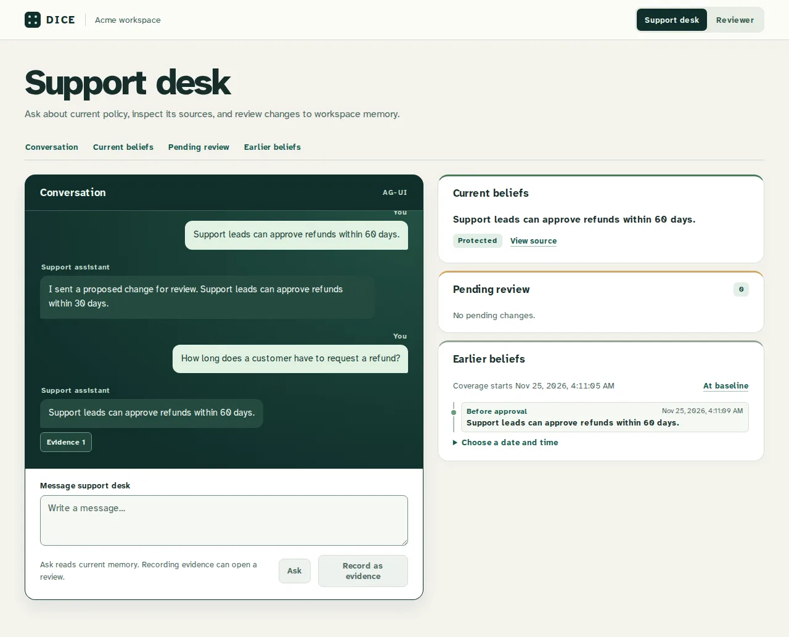
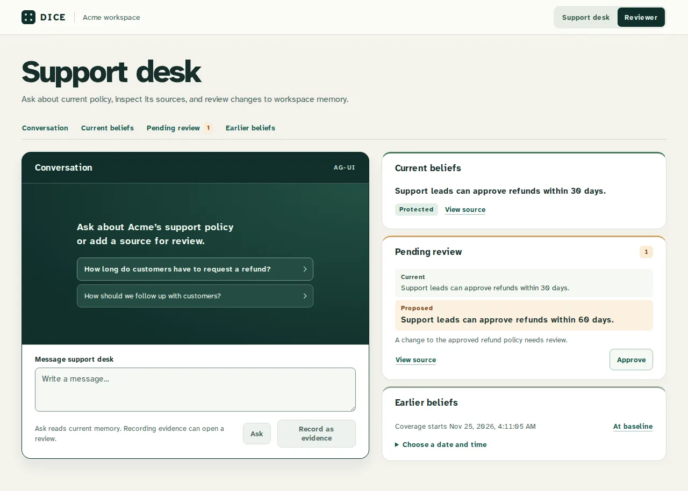
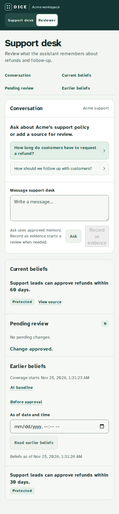

# Governed support chat

A support desk uses DICE to remember approved policy and facts from conversations. An operator can inspect the message behind a proposed change. A reviewer can approve it. The audit trail shows which policy was in force before the approval.

Ask ordinary questions about the current workspace using **Ask**. Answers use the scoped support memory and suggest a relevant next question when the record cannot answer. Use **Record as evidence** when you want to submit a source for extraction and possible review.

## What you’ll see

The support desk asks about refunds after the reviewer approves a 60-day window. The answer cites the source message. **Before approval** compares both recorded belief sets and shows the 30-day rule that was in force before the change.



The review shows the current and proposed wording alongside the [original evidence](docs/screenshots/source-evidence-desktop.webp).



<details>
<summary>Mobile view of the policy history</summary>



</details>

## Run locally

Use Java 21, Bun, and Node.js 22.12 or later. The server resolves DICE `0.5.0-SNAPSHOT` from the Embabel snapshot repository and Embabel Agent `1.5.4`. The app uses the published DICE snapshot because it needs the scoped store and durable history APIs.

Build the workbench and its server together.

```sh
./mvnw -B package
java -jar target/dice-governed-chat.jar
```

Open [the support desk](http://127.0.0.1:8080). Spring Boot serves the fingerprinted TypeScript bundle and the workspace API from the same loopback address. Use `--server.port` to choose a different port.

For frontend development, run the server and then start Vite from `web` with `bun run dev --host 127.0.0.1`. The dev server proxies the API to port 8080. Set `DICE_API_URL` if you change the backend port.

## Ask the support desk

Ask “How much time does a customer have to request a refund?” Then ask “What does that mean for the support lead?” Chat answers from active claims in the authorized workspace. Pending proposals stay in review until a reviewer approves them. If the workspace cannot answer, the assistant offers a question it can answer from the current record.

The browser sends AG-UI runs to `POST /api/workspaces/{workspace}/chat`. It sets `forwardedProps.intent` to `ask` for questions and `record` for evidence. The ask path reads a scoped snapshot and keeps the conversation as context. A `governed.citations` AG-UI event pairs the assistant message with validated claims and their source IDs. Open an **Evidence** button to inspect the original message. It sends no question text through extraction or policy revision. Clients using the original endpoint without an intent continue to submit evidence.

## Follow a policy change

1. As **Support desk**, enter “Support leads can approve refunds within 60 days.” and select **Record as evidence**. The claim goes to review. The pinned 30-day policy remains current.
2. Compare the proposal with the current belief. Open **View source** to read the original message.
3. Switch to **Reviewer** and approve the change. The 60-day policy becomes current. Its source still points to the original support message.
4. Select **Before approval** in **Earlier beliefs**. The comparison shows which beliefs changed. Use **Choose a date and time** to inspect another snapshot. A time before the baseline returns unavailable.
5. Restart the server with the same database and reopen the support desk. The policy and history remain available.

Record “Email is our preferred follow-up channel.” followed by “Phone is our preferred follow-up channel.” The second claim gives Embabel Decision an existing fact to compare. Protected policy follows the approval workflow.

## What DICE does

| What the app needs | DICE API |
| --- | --- |
| Store propositions in SQLite | `dice-starter-sqlite` auto-configuration |
| Extract claims and ground their mentions in the incoming message | `PropositionPipeline` |
| Screen extracted claims for sufficient confidence | `ConfidenceGate` |
| Read active claims within one workspace | `ScopedReads` and `ContextReadScope` |
| Choose a bounded set of facts and keep the approved policy in it | `ContextBudget` |
| Register the opt-in audit schema | `AuditLogSchema` |
| Record proposition changes and read earlier belief sets | `AuditingPropositionRepository` and `DrivineAuditLogStore` |

The SQLite starter configures the persistent proposition store from the datasource in [application.yml](src/main/resources/application.yml). [StorageConfiguration](src/main/java/example/dice/governed/StorageConfiguration.java) registers the opt-in audit schema and uses the starter’s persistence manager and Spring transaction manager. [Storage](src/main/java/example/dice/governed/Storage.java) wraps the starter’s store in `AuditingPropositionRepository`. The demo stores grounded mentions on propositions and uses their types and spans to compare claims.

The application owns source messages, pending reviews, and recent approval checkpoints. Their tables live in the same SQLite database, so one transaction covers app rows and DICE rows. Historical belief sets include the recorded proposition fields.

## How a write commits

A message submitted with **Record as evidence** is handled in two phases.

1. [Workflow](src/main/java/example/dice/governed/Workflow.java) takes a scoped snapshot in a short transaction. Extraction and [AdmissionPolicy](src/main/java/example/dice/governed/AdmissionPolicy.java) then run outside the transaction, including any `DecisionService` call.
2. Commit through `audit.duringWrite`. Recheck the message ID and the active proposition revisions inside the transaction. Repeating the same ID and text returns an already-processed response. Reusing the ID for different text, or planning from facts that changed in the meantime, returns `409 Conflict`. A successful commit writes the source, reviews, proposition changes and audit records together.

Approval looks up the review by exact workspace and review ID. One transaction checks the target revision, supersedes the prior fact, stores the approved one, retires the review, and saves before and after timestamps. The comparison reads both belief sets from the DICE audit log. If any write fails, the whole approval rolls back.

The desk reads current beliefs and pending reviews inside the same transaction. Source messages are immutable and fetched separately by workspace and ID. Historical reads require a complete baseline for the workspace. Each workspace records that baseline before it accepts writes. A time before the baseline returns unavailable.

The demo budgets each current workspace read for 200 active propositions. Approval looks up the pending review by ID and checks its target against the scoped active facts. The historical view still reconstructs the complete belief set for the requested instant.

Open an existing `data/governed-chat.sqlite` to resume the workspace and approve reviews that were already pending.

## Adapting the example

Keep the transaction boundary when adapting the workflow.

- Run model calls outside the transaction. Recheck what the plan read and commit inside one.
- Write audit records in the same transaction as the change they describe.
- Keep app-owned rows on the DICE datasource when they must change together with propositions.
- Return `409 Conflict` for a stale plan so the client can retry against current facts.

Replace the example auth and refund rules with your application’s policy.

- **Identity.** The server maps each demo token to a fixed workspace and role. [DemoAccessProperties](src/main/java/example/dice/governed/DemoAccessProperties.java) binds the server keys under `governed.demo`. The bundled browser uses the default desk and reviewer tokens. The application checks workspace membership and reviewer permissions. Integrate your identity provider and workspace membership rules before exposing an adapted application.
- **Refund classifier.** The refund workflow checks the full extracted claim for one supported workspace-wide rule, such as “The refund window is 60 days.” A recognized change can replace the pinned rule after review. A customer-specific exception or unsupported wording stays pending for clarification. A recognizable completed event, such as “Alice received a partial refund yesterday,” enters ordinary memory. Replace it with rules for your own domain.

For ordinary claims the app asks `DecisionService` through a model role to classify the claim against candidates from the same workspace. If the decision cannot identify a safe change, the proposal remains available for inspection and approval is disabled. Use the source panel on a current proposition or pending review to open its original message.

## Live models

Set `OPENAI_API_KEY` and start the server normally to use live OpenAI chat. The app starts in guided mode if the key is absent. To choose guided mode with a key present, set `SPRING_PROFILES_ACTIVE=offline`.

```sh
./mvnw -B spring-boot:run
```

The scripted profile uses `data/governed-chat.sqlite`. The live profile uses `data/governed-chat-live.sqlite`. Set `GOVERNED_CHAT_DB` to override the path. Keep provider credentials outside the repository.

| Setting | Default in the live profile | Use |
| --- | --- | --- |
| `GOVERNED_CHAT_MODEL` | `gpt-4.1-mini` | Answer questions and extract claims from submitted evidence. |
| `GOVERNED_CHAT_DECISION_MODEL` | `gpt-4.1-mini` | Answer the typed questions for the `dice-revision` role. |
| `GOVERNED_CHAT_EMBEDDING_MODEL` | `text-embedding-3-small` | Supply embeddings to the DICE store. |

## Verify

Install Chromium for Playwright once from the `web` directory.

```sh
cd web
bun install --frozen-lockfile
bunx playwright install chromium
```

Run `./scripts/verify` from the repository root. It builds the server and web app, then runs Chromium against the packaged jar with a temporary database. The browser test opens an AG-UI citation, checks the role-gated approval, and reloads the comparison from durable history. The Java progression test rejects cross-workspace reads, reopens the database with a pending review, and checks the current and earlier policy after approval.
